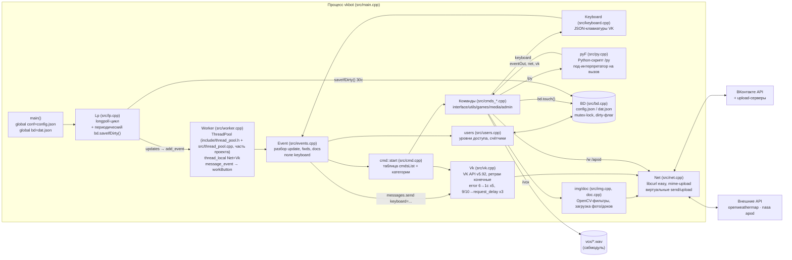

# Блочная схема проекта

Обновлено: 2026-10-23. Схема соответствует текущему коду (`src/`, `include/`, `tests/`).

## Основной поток данных

## Модули

| Модуль | Файлы | Ответственность |
|---|---|---|
| Точка входа | `src/main.cpp` | инициализация Python (опц.), curl global, запуск longpoll |
| Longpoll | `lp.*` | получение updates, переподключение при `failed`, периодическое сохранение `bd` |
| Пул/диспетчер | `worker.*`, `cmd.*` | разбор команды по первому слову, права (`acess`, по `eventIn.user`), конвейер `message_event` |
| Команды | `cmds.h` + `cmds_{interface,utils,games,media,admin}.cpp` | реализации с явной сигнатурой `(Event& in, Event& out, Worker*)`; игровые карты — `shared_ptr`, `lock_guard` |
| Клавиатуры | `keyboard.*` | сборка JSON-клавиатур VK (callback/text/link, цвета, строки, inline/one_time) |
| VK API | `vk.*`, `net.*` | POST-методы, encode/upload, конечные ретраи; `Net` виртуален для mock-тестов |
| События/вложения | `events.*`, `doc.*` | модели Event/Doc, `send()` (messages.send / wall.createComment), приложение keyboard |
| Пользователи | `users.*` | кеш `dat.json:users`, права 1–5 |
| Хранилище | `bd.*`, `fs.*` | два JSON-файла; `bd` — dirty-флаг (`touch`/`saveIfDirty`); `fs::safeWriteData` — запись через `.safe` + rename |
| Изображения | `img.*` | загрузка/декод, фильтры pix/crt/neon (векторный `neonColors`) |
| Игры | `game.*`, bc в cmds | «линксы» 4×4 и «быки и коровы» (с клавиатурой цифр) в памяти |
| Python | `py.*`, `py_casters.h` | pybind11, embedded `vkcppbot`, под-интерпретатор на `/py` |
| Утилиты | `str.*`, `timer.*` | UTF-8 lowercase (ручной, без codecvt)/сплит, секундомеры |
| Тесты | `tests/` | `units.cpp` (+`fakenet.h` — мок сети), `py_integration.cpp`; ctest |

## Потоки выполнения (важно для правок)

- Потоков два вида: main (longpoll) + 5 worker-потоков пула.
- Общие данные: `conf`, `bd` (блокировка `.lock`), `gameL`/`bcL` и карты
  `gameNew/gameUsers/randNumbers/bcDraft` в `src/cmds_games.cpp` (доступ только под мьютексом).
- Нажатие кнопки: `message_event` → `Worker::workButton` → `sendMessageEventAnswer` +
  диспетчеризация payload как команды (общая таблица `cmdsList`).
- Python: каждый `/py` — новый под-интерпретатор в worker-потоке; главный поток не должен
  держать GIL (см. `docs/TASKS.md`, фаза 2).
- Тесты гоняют конвейер `Worker::work(event, FakeNet, Vk)` без сети и пула (`tests/fakenet.h`).

## Сабмодули

| Путь | Что | Когда нужен |
|---|---|---|
| `include/thread_pool.h + src/thread_pool.cpp` | ThreadPool (перенесён из субмодуля thr в проект, оптимизирован) | всегда (сборка) |
| `vox/` | wav-фонемы Half-Life | runtime для `/vox` |
| `win32deps/` | win-зависимости | только Windows (не поддерживается) |
