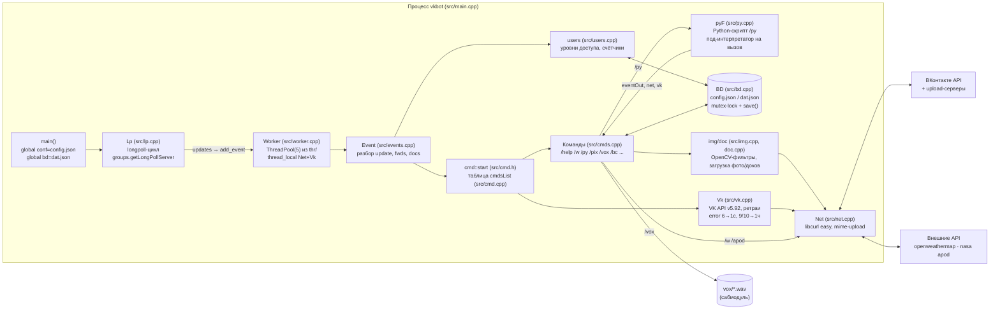

# Блочная схема проекта

Обновлено: 2026-10-22. Схема соответствует текущему коду (`src/`, `include/`).

## Основной поток данных

## Модули

| Модуль | Файлы | Ответственность |
|---|---|---|
| Точка входа | `src/main.cpp` | инициализация Python (опц.), curl global, запуск longpoll |
| Longpoll | `lp.*` | получение updates, переподключение при `failed` |
| Пул/диспетчер | `worker.*`, `cmd.*` | разбор команды по первому слову, права (`acess`) |
| Команды | `cmds.cpp` | вся пользовательская функциональность |
| VK API | `vk.*`, `net.*` | JSON-RPC поверх POST, encode/upload, ретраи |
| События/вложения | `events.*`, `doc.*` | модели Event/Doc, `send()` (messages.send / wall.createComment) |
| Пользователи | `users.*` | кеш `dat.json:users`, права 1–5 |
| Хранилище | `bd.*`, `fs.*` | два JSON-файла, атомарная запись не используется (`safeWriteData` сломан) |
| Изображения | `img.*` | загрузка/декод, фильтры pix/crt/neon, HSV |
| Игры | `game.*`, bc в cmds | «линксы» 4×4 и «быки и коровы» в памяти |
| Python | `py.*` | встраивание, bindings для скриптов /py (миграция на pybind11 — план) |
| Утилиты | `str.*`, `timer.*` | UTF-8 lowercase/сплит, секундомеры |

## Потоки выполнения (важно для правок)

- Потоков два вида: main (longpoll) + 5 worker-потоков пула.
- Общие данные: `conf`, `bd` (блокировка `.lock`), `gameL`/`bcL` mutex'ы в `cmds.cpp`,
  глобальные карты `gameNew/gameUsers/randNumbers`.
- Python: каждый `/py` — новый под-интерпретатор в worker-потоке; главный поток не должен
  держать GIL (см. `docs/TASKS.md`, фаза 2).

## Сабмодули

| Путь | Что | Когда нужен |
|---|---|---|
| `thr/` | ThreadPool.h | всегда (сборка) |
| `vox/` | wav-фонемы Half-Life | runtime для `/vox` |
| `win32deps/` | win-зависимости | только Windows (не поддерживается) |
