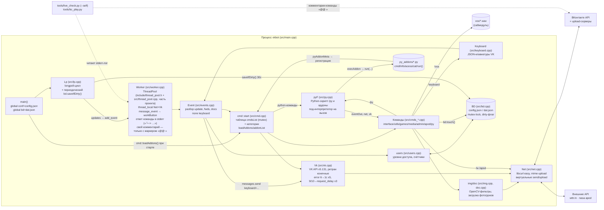

# Блочная схема проекта

Обновлено: 2026-10-24. Схема соответствует текущему коду (`src/`, `include/`, `tests/`, `tools/`).

## Основной поток данных

## Модули

| Модуль | Файлы | Ответственность |
|---|---|---|
| Точка входа | `src/main.cpp` | инициализация Python (опц.), curl global, запуск longpoll |
| Longpoll | `lp.*` | получение updates, переподключение при `failed`, периодическое сохранение `bd` |
| Пул/диспетчер | `worker.*`, `cmd.*` | разбор команды по первому слову, права (`acess`, по `eventIn.user`), конвейер `message_event` |
| Команды | `cmds.h` + `cmds_{interface,utils,games,media,admin,apod,py}.cpp` | реализации с явной сигнатурой `(Event& in, Event& out, Worker*)`; игровые карты — `shared_ptr`, `lock_guard` |
| Клавиатуры | `keyboard.*` | сборка JSON-клавиатур VK (callback/text/link, цвета, строки, inline/one_time) |
| VK API | `vk.*`, `net.*` | POST-методы, encode/upload, конечные ретраи; `Net` виртуален для mock-тестов; фото-загрузка 2026: `photo` в ответе upload-сервера — JSON-строка (принимается как есть), пустой `photo` — повтор попытки |
| События/вложения | `events.*`, `doc.*` | модели Event/Doc, `send()` (messages.send / wall.createComment+reply_to_cid), приложение keyboard; `wall_reply_new` (cid), одиночное поле `attachment` комментария (тип по ключу); пересылки/контекст ответа (`forward`/`fwd_messages`/`action.payload`, `nested`) — в `fwds`, их вложения забирает `img::sources` |
| Пользователи | `users.*` | кеш `dat.json:users`, права 1–5 |
| Хранилище | `bd.*`, `fs.*` | два JSON-файла; `bd` — dirty-флаг (`touch`/`saveIfDirty`); `fs::safeWriteData` — запись через `.safe` + rename |
| Изображения | `img.*` | загрузка/декод, фильтры `toPix/toCrt/toNeon/toInvert/scale/warp` (`warp` — локальные зоны деформации геометрии, разные области по-разному), статический `sources()` — картинка для арт-команд (вложение или фото профиля) |
| Игры | `game.*`, bc в cmds | «линксы» 4×4 и «быки и коровы» (с клавиатурой цифр) в памяти |
| Python | `py.*`, `py_casters.h` | pybind11, embedded `vkcppbot` (fs/str/timer/**img**), под-интерпретатор на `/py` и на каждый вызов аддона; `pyAddonMeta`/`execAddon`; `bytes` для не-UTF-8 ответов `net.send`/`fs.readData` |
| Python-аддоны | `py_addons/*.py` | постоянные python-команды: `cmd/info/acess/cat` + `def run(eventIn, eventOut, net, vk)`; загрузка `cmd::loadAddons()`, `/addons`, `/addonreload` |
| Утилиты | `str.*`, `timer.*` | UTF-8 lowercase (ручной, без codecvt)/сплит, секундомеры |
| Инструменты | `tools/` | `live_check.py` — живые проверки комментариями-командами (режим `--self` с маркером «@@ »), `bc_play.py` — автоигра «Быки и коровы», `vk_user_token.py` — user-токен; `apod.py` — standalone-постинг (вне бота) |
| Тесты | `tests/` | `units.cpp` (+`fakenet.h` — мок сети), `py_integration.cpp`; ctest |

## Потоки выполнения (важно для правок)

- Потоков два вида: main (longpoll) + 5 worker-потоков пула.
- Общие данные: `conf`, `bd` (блокировка `.lock`), `gameL`/`bcL` и карты
  `gameNew/gameUsers/randNumbers/bcDraft` в `src/cmds_games.cpp` (доступ только под мьютексом).
- Нажатие кнопки: `message_event` → `Worker::workButton` → `sendMessageEventAnswer` +
  диспетчеризация payload как команды (общая таблица `cmdsList`).
- Комментарий к записи стены (`wall_reply_new`) — тоже команда: `Event::cid` хранит id
  комментария, ответ уходит `wall.createComment` с `reply_to_cid` (в ветку). Комментарии от
  имении сообществ (`from_id < 0`) обрабатываются (уровень 1 в bd без `users.get`), собственные
  комментарии страницы игнорируются (`from_id == peer_id` — защита от петли), **кроме**
  начинающихся с маркера «@@ » — это режим самопроверки чекера (`live_check.py --self`),
  маркер вырезается перед диспетчеризацией. Текст ответа команды печатается в stderr
  («└─> …», ≤300 симв.) — без него ответ комментария нечем прочитать (`wall.getComments`
  group-токеном недоступен, как и удаление комментариев — `wall.deleteComment` = ошибка 27).
- id в 2026: `from_id/peer_id/owner_id/user.id` — знаковый `int64_t` (сообщества отрицательные,
  диалоги с ботами ~2·10¹¹); `Doc::upload*/img::get*` принимают знаковый `peer_id`.
- Python: каждый `/py` — новый под-интерпретатор в worker-потоке; главный поток не должен
  держать GIL (см. `docs/TASKS.md`, фаза 2). Тот же порядок для вызовов python-аддонов
  (`py_addons/`, фаза 12): `cmd::loadAddons()` читает каталог при старте и по `/addonreload`,
  команды регистрируются в `cmdsList` (флаг `pyAddon`; при перечитывании старые снимаются,
  для новых разделов регистрируется текстовый ярлык). Таблица команд под мьютексом —
  диспетчер копирует запись под локом, `/addonreload` из worker-потока безопасен.
- Тесты гоняют конвейер `Worker::work(event, FakeNet, Vk)` без сети и пула (`tests/fakenet.h`).

## Сабмодули

| Путь | Что | Когда нужен |
|---|---|---|
| `include/thread_pool.h + src/thread_pool.cpp` | ThreadPool (перенесён из субмодуля thr в проект, оптимизирован) | всегда (сборка) |
| `vox/` | wav-фонемы Half-Life | runtime для `/vox` |
| `win32deps/` | win-зависимости | только Windows (не поддерживается) |
